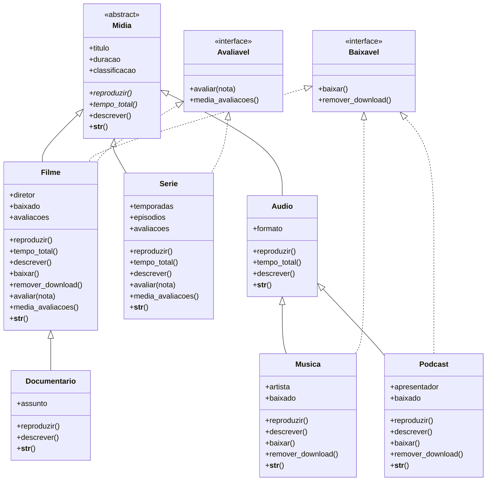

# Diagrama de classes

Este diagrama representa a modelagem do **Projeto Final (Grupo 1 — Plataforma de Streaming)** e é atualizado a cada parte da disciplina.

## Como ler

- Seta contínua com ponta vazada (`<|--`): **herança** ("é um").
- Seta tracejada com ponta vazada (`<|..`): a classe **implementa** a interface ("sabe fazer").
- `<<abstract>>`: classe abstrata. Os métodos abstratos levam `*` depois do nome e aparecem em itálico.
- `<<interface>>`: interface, apenas com métodos.

## Histórico

- **Parte 1:** classes, atributos, métodos e herança.
- **Parte 2:** classe abstrata (`Midia`) e interfaces (`Baixavel` e `Avaliavel`).
